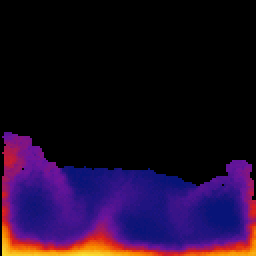
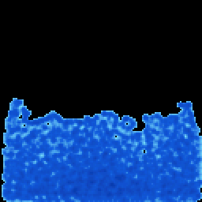
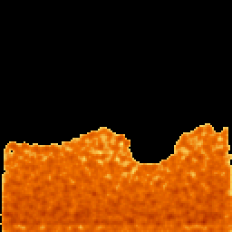
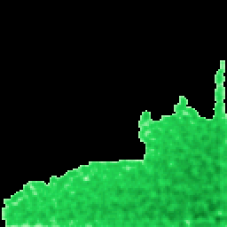
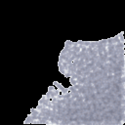

# fluid-sim

<p align="center">
  
  <br>
  <sub>Heat convection mode, rendered by the desktop harness at 2× (<code>HEAT=1 HOLD=1 SWAY=0.25</code>).</sub>
</p>

A particle fluid that sloshes around a 128×128 display when you tilt or
shake the board. Runs on the [LOLIN S3 Mini Pro](https://www.wemos.cc/en/latest/s3/s3_mini_pro.html)
(ESP32-S3, 0.85" TFT, QMI8658C IMU) at 50–60 fps with 780 particles, plus a
heat-convection mode where a heater follows gravity and plumes roll through
the pool.

- Smoothed-particle fluid (Clavet et al. double density relaxation) in a
  self-contained header you can also run on your desktop.
- Gravity comes straight from the accelerometer: tilting *and* shaking move
  the liquid the right way, because the effective gravity in the board's
  frame is minus the measured acceleration. The gyro adds the spin: twist
  the board and the pool swirls (Euler, centrifugal and Coriolis terms).
- Hand-written drivers for the GC9107 panel (DMA, double-buffered) and the
  QMI8658C IMU. No display library to configure.
- Physics on core 1, rendering on core 0, with the heaviest solver passes
  split across both cores.
- Four colour themes and a thermal mode, all on the buttons. Settings
  persist in flash.

## Hardware

Just the board. No wiring. Everything used (TFT, IMU, three buttons) is on
the LOLIN S3 Mini Pro. Pin assignments are in [docs/HARDWARE.md](docs/HARDWARE.md).

## Build and flash

[PlatformIO](https://platformio.org/) core is all you need (the VS Code
extension or `pip install platformio` both work).

```
git clone https://github.com/rderr/fluid-sim.git
cd fluid-sim
pio run -t upload
pio device monitor      # optional: stats, button events, calibration output
```

**First flash on a board still running the factory MicroPython:** hold the
BOOT button while plugging in the USB cable, then run the upload. MicroPython's
USB stack can't be reset into the bootloader by esptool. After that, plain
`pio run -t upload` works every time.

## Controls

| Button | Press | Hold 1.5 s |
|---|---|---|
| IO0 (BOOT) | Next mode: water, lava, slime, mercury, heat convection | |
| IO47 | Next IMU-to-screen mapping (if the liquid falls the wrong way) | |
| IO48 | Respawn the fluid | Calibrate level and gyro zero (board flat and still on a table) |

Over the serial port, `m` cycles the mode and `p` toggles per-phase timing
output.

## Tuning

Every physical knob (thickness, splashiness, cohesion, compressibility,
gravity scale, heater strength, buoyancy…) is a documented field in
`src/fluid.h`, with a note on what you see when it goes up or down.
[docs/TUNING.md](docs/TUNING.md) walks through them in plain language and
shows how to preview a change on your desktop before flashing:

```
c++ -O2 -std=c++11 -Isrc tools/sim_test.cpp -o /tmp/sim_test
SIGMA=5 /tmp/sim_test /tmp/frames      # prints stats, writes BMP frames
```

## How it works

[docs/ARCHITECTURE.md](docs/ARCHITECTURE.md) covers the solver, the
renderer, the dual-core pipeline, the frame budget, and the things that
were tried and didn't pay off.

## Project layout

```
platformio.ini       board + build flags
src/main.cpp         loop: IMU → physics → render → display; buttons, modes, settings
src/fluid.h          particle fluid + heat convection (no Arduino deps)
src/render.h         density splat → colour LUT framebuffer (no Arduino deps)
src/display.h        GC9107 driver, DMA SPI, double buffer
src/imu.h            QMI8658C driver with retry + I2C bus recovery
tools/sim_test.cpp   desktop harness: scripted tilt/shake, stats, BMP frames
docs/                hardware, tuning, architecture notes
```

## The fluids

| Water | Lava | Slime | Mercury |
|:-:|:-:|:-:|:-:|
|  |  |  |  |
| tilt, flip, shake, settle | hard tilt, then settle | rocking | flip and shake |

Same physics, different palettes; the mode button cycles through them and
then into heat convection.

## Making the animations

All GIFs come from the harness, not a camera. Each run writes every Nth
frame as `anim_NNNN.bmp` from `START` seconds onward:

```
mkdir -p /tmp/anim
HEAT=1 HOLD=1 TILT=0 SWAY=0.25 SECONDS=18 START=6 DUMP=3 /tmp/sim_test /tmp/anim 780   # heat
THEME=1 SLOSH=1 SECONDS=8 START=1.5 DUMP=3 /tmp/sim_test /tmp/anim 780                # lava
THEME=2 HOLD=1 TILT=0 SWAY=0.6 SECONDS=10 START=2 DUMP=3 /tmp/sim_test /tmp/anim 780  # slime
```

`THEME` is 0–3 (water, lava, slime, mercury), `SWAY` adds a rocking tilt,
`SLOSH` is a hard tilt then settle, and with no scenario flag the run is
the default tilt, flip, shake, settle sequence. Assemble the frames with
Pillow or ImageMagick (`magick /tmp/anim/anim_*.bmp -scale 200% -delay 5 -loop 0 out.gif`).

## Acknowledgements

- The solver implements Clavet, Beaudoin and Poulin, *Particle-based
  Viscoelastic Fluid Simulation*, SCA 2005. The step structure (viscosity
  impulses, advection, double density relaxation, velocity from positions)
  is theirs; the code is this project's.
- The GC9107 init sequence and panel offsets come from the
  [CircuitPython](https://circuitpython.org/) board definition for the
  LOLIN S3 Mini Pro (MIT licensed), the one sequence verified to work on
  this panel.
- Pin assignments are from the Wemos schematic. The QMI8658C register map
  is from the QST datasheet, cross-checked against the
  [FastIMU](https://github.com/LiquidCGS/FastIMU) driver.
- The fast inverse square root is the classic Quake III routine.

## License

MIT, see [LICENSE](LICENSE).
